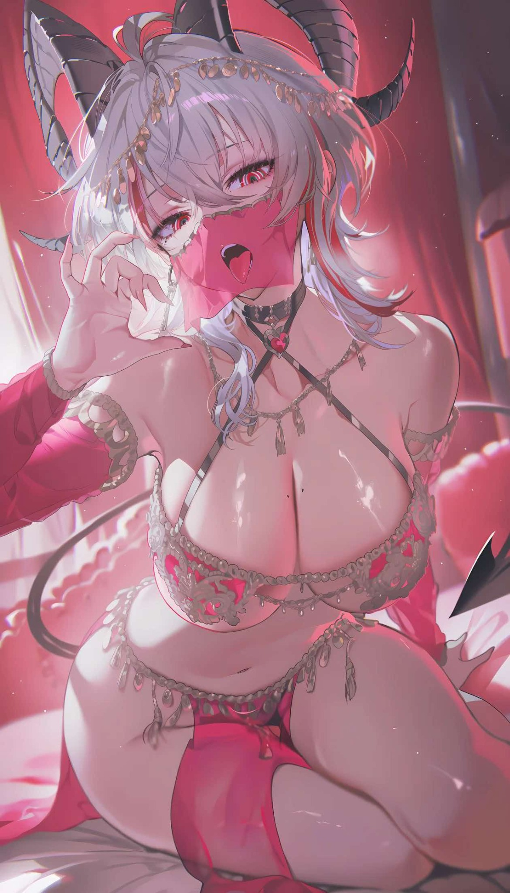

# 绯红戏剧系｜风格卡

## 0. 基本信息（Metadata）

| 字段 | 内容 |
|---|---|
| 资产 ID | `STYLE-CRIMSON-THEATRE` |
| 版本 | v1.0 |
| 类型 | 戏剧舞台光影与渲染风格 |
| 状态 | 已确认的独立风格方向 |
| 适用范围 | 舞台感肖像、戏剧性人物近景、帷幕空间 |
| 参考图 | `../references/STYLE-CRIMSON-THEATRE-Reference.jpg` |
| 来源说明 | 用户提供的原始参考图 |

### 本卡参考图

**原图来源：** 用户提供的绯红戏剧系原始参考图；作者、原帖与许可未知。

本卡只记录可复用的画法特征。参考图中的角色身份、服装、动作、表情、镜头与场景，不因使用本卡而自动迁移。

## 1. 风格摘要（Style Identity）

以暗酒红空间和暖金／暖红侧光划分主次。大面积暗背景压住画面，暖色光穿过帷幕或从侧面切入，焦点落在眉眼、手势、服装轮廓与少量金属高光。

## 2. 线条与边缘（Line & Edge）

人物轮廓与衣装结构清楚但不僵硬；面部、手势和关键饰件边缘优先，背景帷幕边缘可柔化。

## 3. 光源与明暗（Lighting & Value）

暖红侧光或暖金侧光作为主光，帷幕和暗背景吸收大面积亮度；人物面部与手势保留局部高光。

## 4. 色彩体系（Color Palette）

暗酒红、绯红、深棕、暖金为主；深色背景承托主体。角色本身的固有配色由角色卡决定，红色可仅存在于环境。

## 5. 材质表现（Material Rendering）

帷幕呈现厚重织物与柔软褶皱；金属饰件用少量锐利点高光；轻纱与皮革需有不同透光和反射。

## 6. 空间与景深（Depth & Composition Rendering）

背景帷幕柔化，人物面部、手势与衣装轮廓清楚；可用侧前方、低机位或回望，但不把特定姿势锁为画风。

## 7. 稳定画法锁（Style Locks）

以下特征是调用本卡时必须保留的画法核心：

1. 暗酒红舞台空间与暖色侧光。
2. 焦点集中于眉眼、手势和服装轮廓。
3. 背景帷幕较软，金属高光克制。

## 8. 可选迁移与明确排除（Transferable / Non-transferable）

**可选迁移：** 侧前方视角、低机位、回望、扶帘、旋转、抬手或停步可作为可选构图／动作模板，须在 SHOT 中单独指定。

**明确排除：** 不得自动继承参考图人物的发型、面容、体态、服装、坐姿或原图的具体裁切。GPT 龙娘衣装仍按其角色卡使用白、浅紫和金色，绯红可保留在舞台环境。

## 9. 稳定提示词（Reusable Prompt Block）

> 戏剧舞台空间，暗酒红与深棕背景，暖红或暖金侧光穿过层叠帷幕；人物眉眼、手势和衣装轮廓清晰，金属点高光克制，背景帷幕柔化，保持角色本身配色不被环境色覆盖。

## 10. 风格偏离判据（Failure Criteria）

1. 全图被高饱和红色铺满，缺少暗部层次。
2. 主光没有明确方向，人物像被均匀照亮。
3. 人物眼神和手势失去焦点。
4. 帷幕、金属和轻纱呈现相同材质。
5. 环境红色强行改变角色固有服装配色。

任一核心画法锁明显缺失，或出现上述严重偏离，应判定本次风格迁移未通过；可在 SHOT 中调整强度，但不得静默改写风格卡。

## 11. 验证资产与版本记录（Validation & Version History）

**参考图文件：** `../references/STYLE-CRIMSON-THEATRE-Reference.jpg`  
**来源状态：** 用户提供的原始参考图  
**版本记录：** v1.0：固定暗酒红舞台空间、暖侧光、帷幕层次和克制金属高光；与银辉秘仪系分开维护。

| 版本 | 更新内容 |
|---|---|
| v1.0 | v1.0：固定暗酒红舞台空间、暖侧光、帷幕层次和克制金属高光；与银辉秘仪系分开维护。 |
| 后续版本 | 仅在用户确认新增画法特征或迁移范围后升级；保留旧版与验证图号。 |
