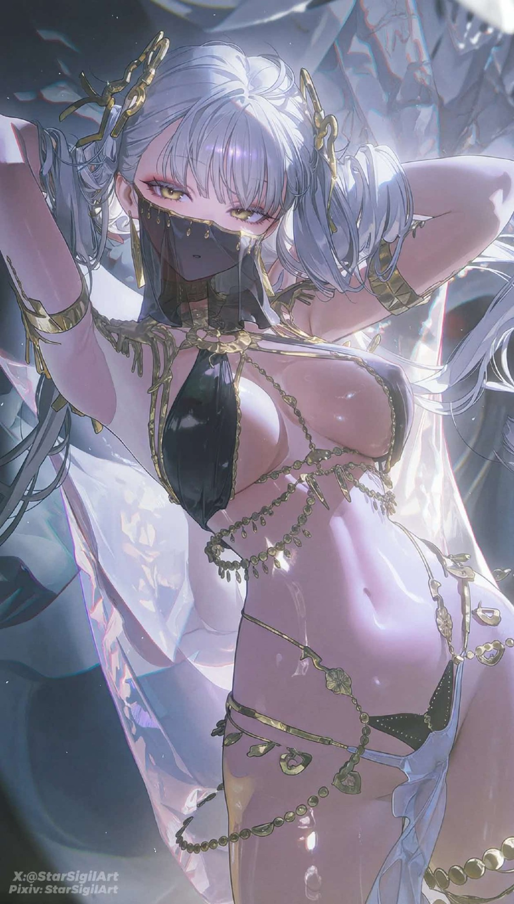

# 银辉秘仪系｜风格卡

## 0. 基本信息（Metadata）

| 字段 | 内容 |
|---|---|
| 资产 ID | `STYLE-SILVER-RITUAL` |
| 版本 | v1.0 |
| 类型 | 冷色仪式感幻想插画的光影与材质方案 |
| 状态 | 已确认的独立风格方向 |
| 适用范围 | 幻术师主题、镜厅、冷光空间、仪式感人物插画 |
| 参考图 | `../references/STYLE-SILVER-RITUAL-Reference.jpg` |
| 来源说明 | 用户提供的原始参考图 |

### 本卡参考图

**原图来源：** 用户提供的银辉秘仪系原始参考图；作者、原帖与许可未知。

本卡只记录可复用的画法特征。参考图中的角色身份、服装、动作、表情、镜头与场景，不因使用本卡而自动迁移。

## 1. 风格摘要（Style Identity）

以银白、冷灰、蓝灰和浅紫构成高明度区域，深色块集中在阴影与背景。冷白边缘光勾勒头发、金属、石材和服装结构，柔和雾光保留暗面层次。

## 2. 线条与边缘（Line & Edge）

人物与饰件结构边界清楚；金属装饰用明确边线和点高光，雾光区域可柔化背景边缘。

## 3. 光源与明暗（Lighting & Value）

冷白边缘光作为主要塑形光，配合蓝灰阴影与浅紫反光；雾光只在局部空间出现，不吞没结构。

## 4. 色彩体系（Color Palette）

银白、冷灰、蓝灰、浅紫；深色集中在背景与阴影。

## 5. 材质表现（Material Rendering）

金属饰件使用清晰边线和点高光；石材保持低反射；软布与金属具有不同反射特征。

## 6. 空间与景深（Depth & Composition Rendering）

可采用偏轴构图、镜厅或对称空间；人物手势与饰件结构清晰，背景雾光柔化但保留空间深度。

## 7. 稳定画法锁（Style Locks）

以下特征是调用本卡时必须保留的画法核心：

1. 银白边缘光与低饱和蓝灰阴影。
2. 浅紫反光作为少量补色。
3. 金属、石材和软布的材质差异清楚。

## 8. 可选迁移与明确排除（Transferable / Non-transferable）

**可选迁移：** 抬臂、转头、持物手势、肃静回望、镜厅和冷光空间可选迁移；动作与场景须在 SHOT 指定。

**明确排除：** 不得自动继承原图人物的发型、服装、头饰、具体手势和身体比例。幻术师原装皮肤仍按角色卡，不因银辉风格自动改变。

## 9. 稳定提示词（Reusable Prompt Block）

> 冷色仪式感幻想插画，银白边缘光勾勒人物与饰件，低饱和蓝灰阴影，少量浅紫反光；金属以清晰边线和点高光表现，石材低反射，软布具有柔和体积，背景可用克制雾光形成空间深度。

## 10. 风格偏离判据（Failure Criteria）

1. 全图过曝，银白区域失去层次。
2. 阴影变成纯黑或高饱和蓝紫。
3. 金属、石材和软布没有材质差异。
4. 雾光遮盖人物和饰件结构。
5. 把原图动作、衣装和角色外貌自动迁移。

任一核心画法锁明显缺失，或出现上述严重偏离，应判定本次风格迁移未通过；可在 SHOT 中调整强度，但不得静默改写风格卡。

## 11. 验证资产与版本记录（Validation & Version History）

**参考图文件：** `../references/STYLE-SILVER-RITUAL-Reference.jpg`  
**来源状态：** 用户提供的原始参考图  
**版本记录：** v1.0：固定银白冷边光、蓝灰阴影、浅紫反光和材质分层；与绯红戏剧系分图输出。

| 版本 | 更新内容 |
|---|---|
| v1.0 | v1.0：固定银白冷边光、蓝灰阴影、浅紫反光和材质分层；与绯红戏剧系分图输出。 |
| 后续版本 | 仅在用户确认新增画法特征或迁移范围后升级；保留旧版与验证图号。 |
